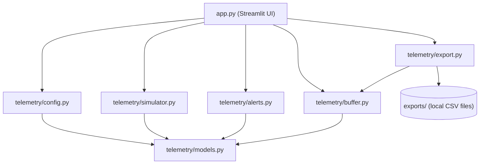
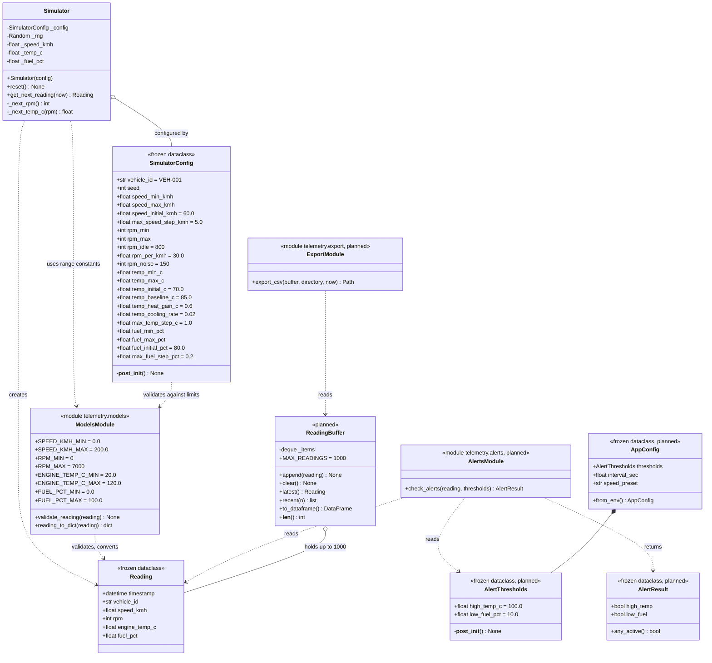
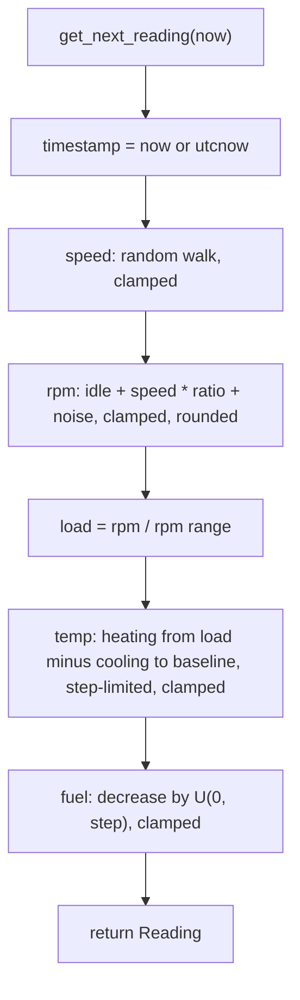
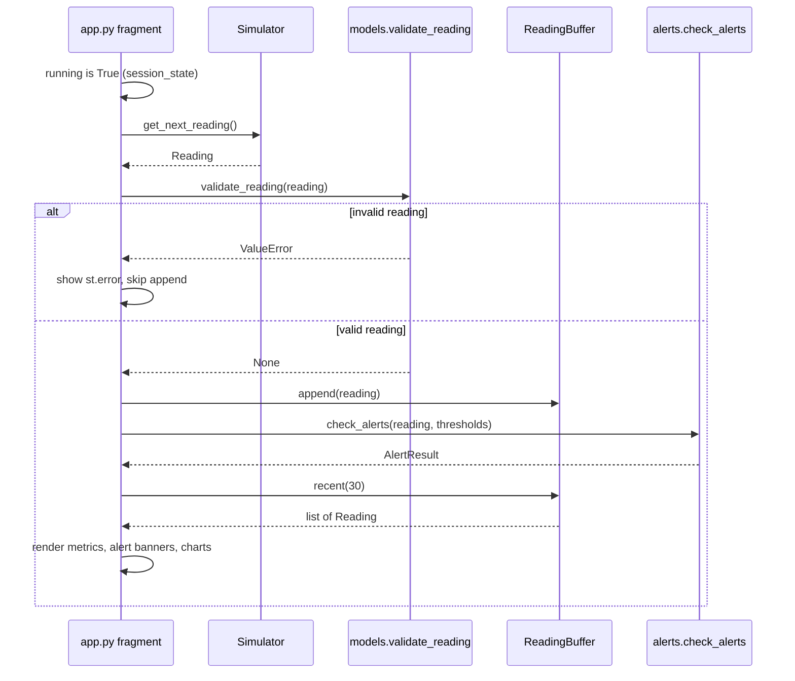
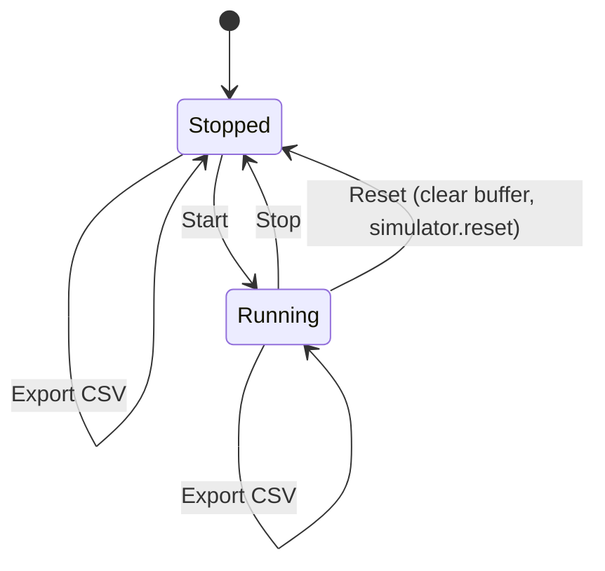
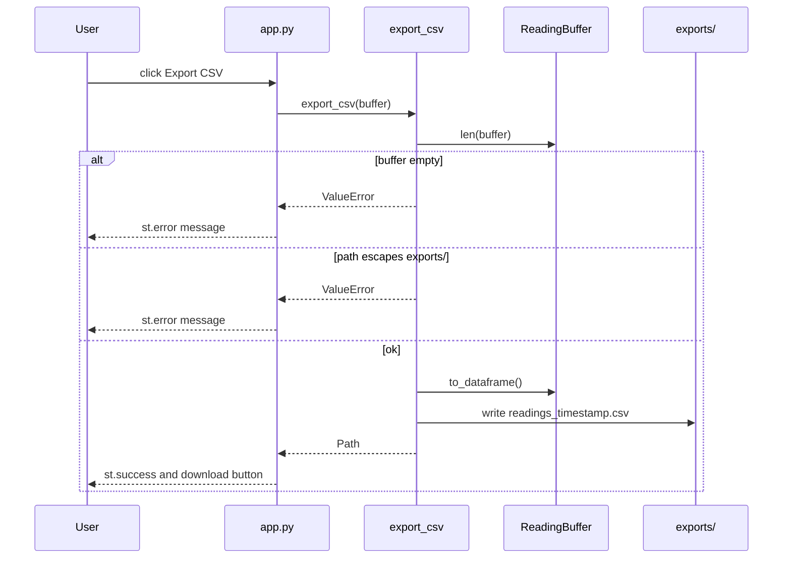
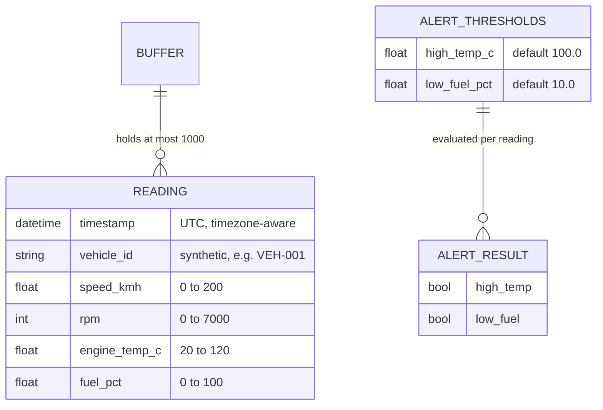

# Vehicle Telemetry Demo - Low-Level Design

**Based on:** [TECH_SPEC.md](TECH_SPEC.md), [IMPLEMENTATION_PLAN.md](IMPLEMENTATION_PLAN.md)
**Scope:** MVP / POC only. Synthetic data, in-memory, single vehicle.

Status legend: **Implemented** = in the repository and tested; **Planned** = defined in the implementation plan, not yet written.

| Module | Phase | Status |
|--------|-------|--------|
| `telemetry/models.py` | 1 | Implemented |
| `telemetry/simulator.py` | 2 | Implemented |
| `telemetry/alerts.py` | 3 | Implemented |
| `telemetry/buffer.py` | 4 | Implemented |
| `telemetry/export.py` | 4 | Implemented |
| `telemetry/config.py` | 4 | Implemented |
| `app.py` | 5 | Implemented |

---

## 1. Component View

Dependencies point downward; `models` is the shared base, and `alerts` has no dependency on the simulator or Streamlit.

## 2. Class Diagram

## 3. Module Specifications

### 3.1 `telemetry/models.py` (Implemented)

| Item | Detail |
|------|--------|
| `Reading` | Frozen dataclass; one sample. `timestamp` is a timezone-aware `datetime`. |
| Range constants | Single source of truth for limits; also used by `SimulatorConfig` and the planned alert/threshold validation. |
| `validate_reading(reading)` | Returns `None`; raises `ValueError` on the first failed rule (see table below). |
| `reading_to_dict(reading)` | `dataclasses.asdict`; keys equal the CSV column names. |

Validation rules, in evaluation order:

| Order | Rule | Error text contains |
|-------|------|---------------------|
| 1 | `timestamp` is a `datetime` with a UTC offset | `timestamp` |
| 2 | `vehicle_id` is a non-blank `str` | `vehicle_id` |
| 3 | Each numeric field is `int` or `float`, not `bool` | field name |
| 4 | Each numeric field is finite (no NaN, inf) | field name |
| 5 | Each numeric field is within its inclusive range | field name |

Ranges are inclusive at both ends.

| Field | Unit | Min | Max |
|-------|------|-----|-----|
| `speed_kmh` | km/h | 0 | 200 |
| `rpm` | rev/min | 0 | 7000 |
| `engine_temp_c` | deg C | 20 | 120 |
| `fuel_pct` | percent | 0 | 100 |

### 3.2 `telemetry/simulator.py` (Implemented)

**Design rules**
- Pure generator: no threads, timers, or sleeping. The caller decides when to ask for a reading.
- Private `random.Random(seed)` instance; the global RNG is never used.
- `now` is injectable so tests do not depend on the clock; the default is `datetime.now(UTC)`.
- `SimulatorConfig` is frozen and validated in `__post_init__`; invalid configs raise `ValueError`.
- `get_next_reading` does not call `validate_reading`; the caller validates at the module boundary.

**Config validation**
- Blank `vehicle_id` is rejected.
- For each metric, `limit_low <= min < max <= limit_high`, where limits come from `models.py`.
- Initial speed, temperature, and fuel must lie inside their configured min/max.
- Step, noise, gain, and rate parameters must not be negative.

**Update equations** (one call advances the state one tick, in this order)

| Step | Metric | Rule |
|------|--------|------|
| 1 | Speed | `speed = clamp(speed + U(-max_step, +max_step), min, max)` |
| 2 | RPM | `rpm = clamp(round(idle + speed * rpm_per_kmh + U(-noise, +noise)), min, max)` |
| 3 | Temperature | `load = (rpm - rpm_min) / (rpm_max - rpm_min)`; `delta = clamp(heat_gain * load - cooling_rate * (temp - baseline), -max_step, +max_step)`; `temp = clamp(temp + delta, min, max)` |
| 4 | Fuel | `fuel = clamp(fuel - U(0, max_step), min, max)` |

`U(a, b)` is `rng.uniform(a, b)`. The RNG is drawn in the order: speed, RPM noise, fuel. Temperature uses no random draw.

At steady state, temperature settles at `baseline + (heat_gain / cooling_rate) * load`, which is 85 C plus up to 30 C with the defaults. The 100 C alert therefore needs about 3500 RPM.

**Reset**: `reset()` recreates the RNG from `config.seed` and restores the three state values. With a fixed seed, the sequence after `reset()` is identical to the original. With `seed=None`, each reset produces a new non-reproducible sequence.

### 3.3 `telemetry/alerts.py` (Planned, Phase 3)

| Item | Detail |
|------|--------|
| `AlertThresholds` | `high_temp_c` default 100.0, `low_fuel_pct` default 10.0; each must be inside the model range, else `ValueError`. |
| `AlertResult` | `high_temp`, `low_fuel`; `any_active` is `high_temp or low_fuel`. |
| `check_alerts` | High temperature when `engine_temp_c >= high_temp_c`; low fuel when `fuel_pct <= low_fuel_pct`. |

Imports only from `telemetry.models`. Alerts are demo indicators, not safety or diagnostic advice.

### 3.4 `telemetry/buffer.py` (Planned, Phase 4)

| Method | Behavior |
|--------|----------|
| `append(reading)` | Adds to a `deque(maxlen=1000)`; the oldest item is dropped when full. |
| `clear()` | Empties the buffer. |
| `latest()` | Newest reading, or `None` when empty. |
| `recent(n)` | Up to the last `n` readings, oldest first; fewer if fewer exist. |
| `to_dataframe()` | Columns from `reading_to_dict`; empty buffer gives an empty frame with those columns. |

### 3.5 `telemetry/export.py` (Planned, Phase 4)

`export_csv(buffer, directory="exports", now=None) -> Path`

1. Raise a clear error (`ValueError`) if the buffer is empty.
2. Build the filename `readings_<YYYYMMDDTHHMMSSZ>.csv` from the UTC `now`.
3. Create the directory if missing.
4. Resolve the target path and confirm it is inside the resolved export directory; otherwise raise.
5. Write `buffer.to_dataframe()` with `to_csv(index=False)` and return the path.

CSV columns: `timestamp, vehicle_id, speed_kmh, rpm, engine_temp_c, fuel_pct`.

### 3.6 `telemetry/config.py` (Planned, Phase 4)

| Setting | Default | Validation |
|---------|---------|------------|
| `thresholds` | `AlertThresholds()` | As in 3.3 |
| `speed_preset` | `normal` | One of `slow` (2.0 s), `normal` (1.0 s), `fast` (0.5 s) |
| `interval_sec` | from preset | Must be greater than 0 |

Optional environment-variable overrides (`AppConfig.from_env()`) use `TELEMETRY_SPEED_PRESET`, `TELEMETRY_INTERVAL_SEC`, `TELEMETRY_HIGH_TEMP_C`, and `TELEMETRY_LOW_FUEL_PCT`; blank values are ignored and values are validated the same way. An explicit interval overrides the preset interval. No secrets are involved.

## 4. Runtime Behavior

### 4.1 One simulation tick (Phase 5 wiring)

### 4.2 Run-state machine (held in `st.session_state`)

### 4.3 Export flow

## 5. Data Design

Storage is an in-memory `deque` only; restarting the app discards all data. Exports are the only persisted output and are git-ignored.

## 6. Error Handling

| Condition | Raised by | Handling |
|-----------|-----------|----------|
| Malformed or out-of-range reading | `validate_reading` | `ValueError`; UI shows an error and does not append. |
| Invalid simulator config | `SimulatorConfig.__post_init__` | `ValueError` at construction. |
| Invalid thresholds or app config | `AlertThresholds`, `AppConfig` | `ValueError`; UI shows a message. |
| Export with no data | `export_csv` | `ValueError`; UI shows `st.error`. |
| Export path outside `exports/` | `export_csv` | `ValueError`. |

No exception reaches the user as a stack trace; the UI catches `ValueError` at the button and refresh handlers.

## 7. Design Constraints

- The simulator holds no timers or threads, because Streamlit reruns the script and background threads are unreliable. The refresh comes from `st.fragment(run_every=...)`.
- `Simulator`, `ReadingBuffer`, and run flags are created once in `st.session_state` so reruns do not reset them.
- All timestamps are UTC and timezone-aware; metric names carry units.
- Synthetic data only. No real VINs, driver details, or GPS traces; no credentials in code.
- Out of scope: multiple vehicles, databases, cloud services, hardware connections, notifications.

## 8. Test Mapping

| Design element | Test file | Key cases |
|----------------|-----------|-----------|
| Validation rules and ranges | `tests/test_models.py` | Limits accepted, just-outside rejected, naive timestamp, NaN/inf, non-numeric, blank ID |
| Simulator determinism and bounds | `tests/test_simulator.py` | Same seed identical, 1000 valid readings, fuel monotonic, step limits, `reset()`, config validation |
| Alert boundaries (planned) | `tests/test_alerts.py` | Threshold minus 0.1, at, above; both/neither active |
| Buffer (planned) | `tests/test_buffer.py` | Eviction at 1000, `recent(n)` with fewer items |
| Export (planned) | `tests/test_export.py` | Columns and row count, empty buffer error, path confinement |
| Config (planned) | `tests/test_config.py` | Negative interval, unknown preset |
